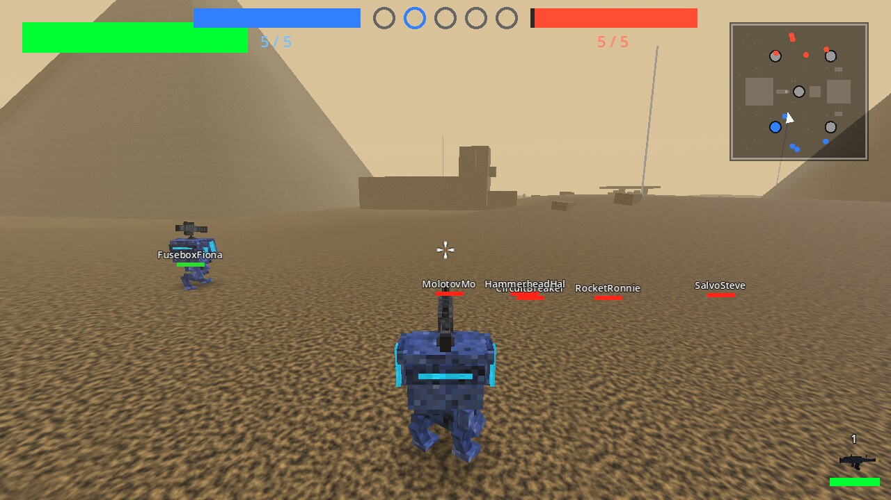

# Hardpoint

Squad-based mech battles in chunky pixel 3D. Pick five mechs, bolt guns onto their hardpoints,
and fight 5 v 5 over beacons -- against bots or other people.



- **11 mechs** from a 175 HP scout to a 1000 HP shielded wall, several with an ability on SPACE:
  stealth, a healing jump, a ramming lunge, a planted ANCHOR.
- **10 weapon families**: rifle, sniper, machine gun, shotgun, rockets, lock-on missiles, laser,
  arc, aerial strike and Patience.
- **8 maps**, **3 modes**, bots from Easy to Elite (named pilots with their own hangars and styles).
- Runs on old hardware: built and tested on a 2009 workstation, aiming for 5 v 5 on a potato.

## Play

Download the newest build from [Releases](https://github.com/jonathandaley/Hardpoint/releases):
`hardpoint_X.Y.Z.x86_64` (Linux) or `hardpoint_X.Y.Z.exe` (Windows). No install.

```bash
chmod +x hardpoint_X.Y.Z.x86_64 && ./hardpoint_X.Y.Z.x86_64   # Linux
```

On Windows the `.exe` isn't code-signed: at "Windows protected your PC" click **More info**,
then **Run anyway**.

- **Single player:** FIND MATCH > SINGLE PLAYER -- pick a map, a mode and how many bots.
- **Online:** FIND MATCH > JOIN; the official server is filled in. SIGN UP on the title screen to
  keep your rating, XP and coins on the server (guests keep a local profile).
- **Your own server:** see [`deploy/README.md`](deploy/README.md), or the flags in
  [`docs/DEVELOPING.md`](docs/DEVELOPING.md).

## Modes

| Mode | Win |
|---|---|
| **Beacons** | Both teams start at 1000 points; every beacon you hold drains the enemy's. First to 0 loses -- or run out of mechs. |
| **Beacon rush** | Beacons, and your team can also spawn at any beacon it holds (unless it's contested). |
| **Death match** | No beacons. Most kills when the 15 minute clock runs out; wiping out a team ends it early. |

Each player brings a squad of up to five mechs. When one dies you pick the next and where it drops in.

## Mechs

| Mech | Class | HP | Hardpoints | Special |
|---|---|---|---|---|
| Slip | Light | 175 | 1 light | the fastest chassis |
| Cesh | Light | 175 | 1 light | STEALTH: invisible to enemy sensors for 24 s |
| Seeker | Light | 175 | 1 heavy | a big gun on a small frame |
| Hornet | Medium | 450 | 2 light | quick skirmisher |
| Hippogriff | Medium | 500 | 3 light | steady all-rounder |
| Pegasus | Medium | 300 | 2 light | JUMP + HEAL: a high leap that repairs it |
| Kestrel | Medium | 300 | 2 light | energy shield (150) that refills |
| Taurus | Medium | 390 | 2 light | LUNGE: springs forward and rams |
| Everest | Heavy | 1000 | 2 heavy | physical front shield, slowest |
| Vesuvius | Heavy | 850 | 3 heavy | the most firepower |
| Denali | Heavy | 900 | 2 heavy | ANCHOR: plants for 6 s, half damage taken, 30% more dealt |

Heavy weapons hit about twice as hard and fire slower. Hover a mech's name in the hangar for its lore.

## Controls

| Key | Action |
|---|---|
| W A S D / mouse | move / look |
| Left click | fire all weapons |
| Right click | fire the selected weapons |
| 1 2 3 4 | add / remove a weapon from the selection |
| R | reload |
| Space | ability |
| V | swap shoulder (shoulder view) |
| Tab | spectate the next mech |
| Esc | pause |

Mouse sensitivity, view, graphics and audio are under SETTINGS.

## Build from source

Godot 4.6.2: `godot --headless --editor --quit` once, then `godot .` in this folder. Tests,
releases and the code's layout are in [`docs/DEVELOPING.md`](docs/DEVELOPING.md).

## License

Code and art: MIT ([`LICENSE`](LICENSE)). The engine, font and sound effects keep their own terms
([`THIRD_PARTY.md`](THIRD_PARTY.md)).
